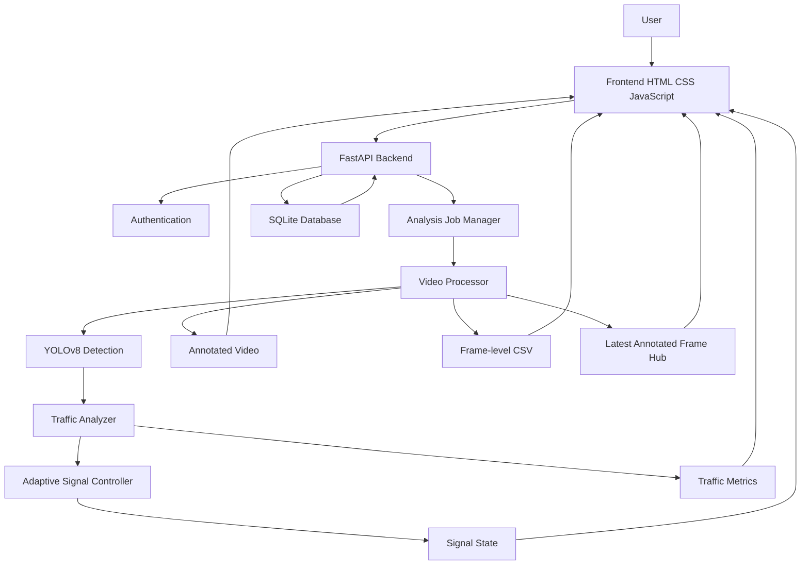
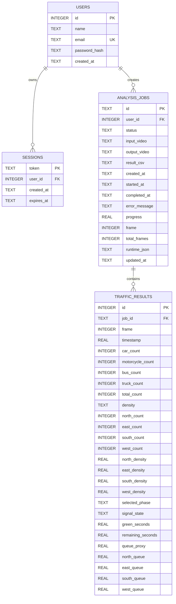

# AI Traffic Signal Control

> **An Intelligent Computer Vision-Based Traffic Monitoring and Adaptive Signal Optimization System.**

AI Traffic Signal Control is a local Windows-based web application that analyzes uploaded traffic videos with **YOLOv8**, counts supported vehicle classes, assigns detections to four traffic approaches, estimates traffic density and queue occupancy, and uses a deterministic adaptive signal controller to select the next signal phase and green duration.

The application provides a FastAPI backend, an HTML/CSS/Vanilla JavaScript frontend, SQLite persistence, annotated processed-video output, frame-level CSV results, live annotated-frame monitoring during processing, automatic signal-state synchronization, analysis history, and downloadable results.

The system generates a **software traffic-signal decision**. It does not directly control physical traffic lights or roadside hardware.

---

## Table of Contents

- [1. Project Overview](#1-project-overview)
- [2. Problem Statement](#2-problem-statement)
- [3. Objectives](#3-objectives)
- [4. Key Features](#4-key-features)
- [5. System Architecture](#5-system-architecture)
- [6. Technology Stack](#6-technology-stack)
- [7. Actual Project Structure](#7-actual-project-structure)
- [8. Vehicle Detection](#8-vehicle-detection)
- [9. Traffic Density and Direction Analysis](#9-traffic-density-and-direction-analysis)
- [10. Adaptive Signal Optimization](#10-adaptive-signal-optimization)
- [11. Application Workflow](#11-application-workflow)
- [12. Live Monitoring and Automatic Signal Updates](#12-live-monitoring-and-automatic-signal-updates)
- [13. Installation and Setup on Windows](#13-installation-and-setup-on-windows)
- [14. Configuration](#14-configuration)
- [15. Running the Application](#15-running-the-application)
- [16. API Documentation](#16-api-documentation)
- [17. Database Design](#17-database-design)
- [18. Output Files](#18-output-files)
- [19. Testing](#19-testing)
- [20. Troubleshooting](#20-troubleshooting)
- [21. Performance Considerations](#21-performance-considerations)
- [22. Security](#22-security)
- [23. Limitations](#23-limitations)
- [24. Future Enhancements](#24-future-enhancements)
- [25. License](#25-license)
- [26. Author / Project Credits](#26-author--project-credits)

---

## 1. Project Overview

The application is designed for traffic-video analysis rather than direct physical traffic-light control.

A user signs in to the local application and uploads a traffic video. The backend validates the video, creates an analysis job, and processes the video in a background thread. For each frame, the configured YOLOv8 model detects vehicles. The application keeps only the four supported vehicle categories:

- Car
- Motorcycle
- Bus
- Truck

Each accepted detection receives a bounding box, confidence value, center point, approach assignment, and queue-zone classification. The traffic analyzer converts these detections into vehicle counts, direction-wise counts, density labels, density ratios, and an estimated queue occupancy proxy.

The adaptive signal controller then uses vehicle demand, density, estimated queue occupancy, waiting time, minimum/maximum green constraints, yellow time, and a fairness rule to determine the current phase and signal state.

The same annotated frame produced by the processing pipeline is published to the frontend through an MJPEG-compatible HTTP stream. The frontend does not run YOLO a second time.

When processing finishes, the generated MP4 and CSV remain associated with the analysis job and can be reviewed through the history and results interfaces.

---

## 2. Problem Statement

Conventional fixed-time traffic signals do not automatically react to changing traffic demand. A road with very few vehicles may receive the same green allocation as a heavily congested road, while another approach waits unnecessarily.

Typical problems include:

- Fixed signal timing.
- Unequal traffic distribution between approaches.
- Unnecessary vehicle waiting.
- Congestion caused by inefficient phase selection.
- Lack of automated traffic-video analysis.
- Limited visibility into why a signal phase was selected.

This project addresses these problems at the software-analysis level by using computer vision to estimate current traffic demand and a deterministic adaptive controller to select a suitable signal phase.

The project **does not claim physical traffic-light control**, because no physical signal hardware integration is present in the supplied source.

---

## 3. Objectives

The implemented objectives are:

1. Detect vehicles from uploaded traffic videos.
2. Count cars, motorcycles, buses, and trucks.
3. Assign detected vehicles to NORTH, EAST, SOUTH, and WEST approaches.
4. Estimate traffic density from configured traffic capacity.
5. Estimate queue occupancy as a clearly labeled proxy.
6. Select an adaptive four-way signal phase.
7. Calculate a bounded green duration.
8. Enforce minimum green, maximum green, yellow, and fairness behavior.
9. Generate an annotated processed video.
10. Generate frame-level CSV traffic results.
11. Store analysis jobs and traffic results in SQLite.
12. Display current traffic and signal information in the dashboard.
13. Synchronize the dashboard with backend signal data automatically.
14. Show already-annotated processing frames during an active analysis.
15. Preserve completed analysis history.
16. Allow users to download completed processed videos and CSV files.
17. Allow an active analysis to be cancelled cooperatively.

---

## 4. Key Features

### Implemented

- Local user registration and login.
- bcrypt password hashing.
- Database-backed HTTP-only session cookie.
- Uploaded-video validation.
- Background video processing.
- YOLOv8 vehicle detection.
- Car, motorcycle, bus, and truck filtering.
- Four-way approach assignment.
- Traffic density classification.
- Direction-wise vehicle counts.
- Estimated queue occupancy proxy.
- Deterministic adaptive signal controller.
- Minimum and maximum green constraints.
- Yellow transition state.
- Waiting-time fairness protection.
- Annotated MP4 generation.
- Frame-level CSV generation.
- SQLite analysis history.
- Automatic signal synchronization through polling.
- Live annotated-frame preview through MJPEG-style streaming.
- Completed processed-video playback.
- Previous processed-video history.
- Downloadable processed video.
- Downloadable CSV.
- Analysis cancellation.
- Restart recovery for jobs that were queued/running when the server stopped.
- Model-readiness indication.
- API health endpoint.
- Automated unit/API tests.

### Not implemented

- Direct physical traffic-light hardware control.
- CCTV camera ingestion.
- WebSocket/SSE transport; current live synchronization uses HTTP polling and the frame stream uses multipart JPEG.
- Unique-vehicle tracking across frames.
- Reinforcement-learning-based signal optimization.
- Cloud deployment.
- Paid APIs.

---

## 5. System Architecture



### Runtime flow

```text
User
  |
  v
Login/Register
  |
  v
Upload video
  |
  v
FastAPI validates file
  |
  v
Analysis Job created
  |
  v
Background VideoProcessor
  |
  +--> YOLOv8
  |      |
  |      +--> vehicle detections
  |
  +--> TrafficAnalyzer
  |      |
  |      +--> counts
  |      +--> approaches
  |      +--> density
  |      +--> queue proxy
  |
  +--> SignalController
  |      |
  |      +--> phase
  |      +--> RED/GREEN/YELLOW
  |      +--> green duration
  |
  +--> annotated frame
  |      |
  |      +--> FrameHub
  |              |
  |              +--> live MJPEG stream
  |
  +--> processed.mp4
  |
  +--> results.csv
  |
  v
SQLite + Dashboard + Results + History
```

---

## 6. Technology Stack

| Category | Technology | Purpose |
|---|---|---|
| Language | Python | Backend and AI/video processing |
| Backend | FastAPI 0.116.1 | HTTP API and application server |
| ASGI Server | Uvicorn 0.35.0 | Runs FastAPI |
| Validation | Pydantic 2.11.7 | Request/data validation |
| Settings | pydantic-settings 2.10.1 | Environment configuration |
| Authentication | bcrypt 4.3.0 | Password hashing |
| Computer Vision | OpenCV 4.12.0.88 | Video I/O, frame processing and JPEG encoding |
| Object Detection | Ultralytics YOLO 8.3.190 | Vehicle detection |
| Numerical Processing | NumPy 2.2.6 | Array/frame operations |
| Data Processing | Pandas 2.3.2 | Dependency/data ecosystem; CSV output is generated directly by Python CSV tools |
| Database | SQLite | Users, sessions, jobs and traffic results |
| Frontend | HTML5, CSS, Vanilla JavaScript | Web interface |
| UI utility | Tailwind CSS CDN | Utility styling configuration in the frontend |
| Icons | Lucide CDN | Interface icons |
| Charts | Chart.js 4.4.7 CDN | Dashboard/result charts |
| Testing | Pytest 8.4.1 | Automated tests |
| Async testing | pytest-asyncio 1.1.0 | Async test support |
| HTTP testing | httpx 0.28.1 | HTTP client/testing support |

The exact backend package pins are stored in `requirements.txt`.

---

## 7. Actual Project Structure

The supplied project contains the following structure:

```text
PROJECT_ROOT/
│
├── .env.example
├── .gitignore
├── requirements.txt
│
├── MODELS/
│   └── yolov8n.pt
│
├── BACKEND/
│   ├── __init__.py
│   ├── main.py
│   ├── auth.py
│   ├── config.py
│   ├── database.py
│   │
│   ├── routes/
│   │   ├── __init__.py
│   │   ├── auth.py
│   │   ├── analysis.py
│   │   ├── dashboard.py
│   │   ├── results.py
│   │   ├── signals.py
│   │   └── about.py
│   │
│   ├── services/
│   │   ├── __init__.py
│   │   ├── frame_hub.py
│   │   ├── job_manager.py
│   │   ├── signal_optimizer.py
│   │   ├── traffic_analyzer.py
│   │   └── video_processor.py
│   │
│   └── tests/
│       ├── __init__.py
│       ├── test_frame_hub.py
│       ├── test_health.py
│       ├── test_optimizer.py
│       └── test_traffic_analyzer.py
│
├── FRONTEND/
│   ├── index.html
│   ├── css/
│   │   └── style.css
│   └── js/
│       └── app.js
│
└── DATA_BASE/
    ├── database/
    │   └── traffic.db
    ├── jobs/
    │   └── .gitkeep
    └── uploads/
        └── .gitkeep
```

### Important modules

| File | Responsibility |
|---|---|
| `BACKEND/main.py` | Creates FastAPI app, registers routers, serves frontend and performs startup initialization |
| `BACKEND/config.py` | Central configuration, paths, vehicle classes, supported formats and approach ROIs |
| `BACKEND/database.py` | SQLite schema, migrations and connection management |
| `BACKEND/auth.py` | Password hashing, password verification and session-cookie helpers |
| `BACKEND/routes/auth.py` | Registration, login, logout and current-user APIs |
| `BACKEND/routes/analysis.py` | Upload, job status, active job, live frame stream and cancellation |
| `BACKEND/routes/dashboard.py` | Dashboard summary and trend APIs |
| `BACKEND/routes/results.py` | History, detail, processed video and CSV APIs |
| `BACKEND/routes/signals.py` | Current signal state API |
| `BACKEND/routes/about.py` | Project metadata/configuration API |
| `BACKEND/services/video_processor.py` | Main YOLO/video/analysis/output pipeline |
| `BACKEND/services/traffic_analyzer.py` | Direction, density and queue-proxy calculations |
| `BACKEND/services/signal_optimizer.py` | Adaptive signal controller |
| `BACKEND/services/job_manager.py` | Background job lifecycle and cancellation |
| `BACKEND/services/frame_hub.py` | Retains only the latest encoded annotated frame per job |
| `FRONTEND/index.html` | Complete single-page application markup |
| `FRONTEND/js/app.js` | Frontend state, API calls, polling, live monitoring, charts and history |
| `FRONTEND/css/style.css` | Application styling |

---

## 8. Vehicle Detection

The configured model is:

```text
MODELS/yolov8n.pt
```

The backend does not silently download a missing model. `video_processor.py` resolves the configured model path and raises a clear error if the file does not exist.

The application accepts only these vehicle categories:

| Vehicle | YOLO class ID |
|---|---:|
| Car | 2 |
| Motorcycle | 3 |
| Bus | 5 |
| Truck | 7 |

Other YOLO classes are ignored by the traffic pipeline.

For every frame:

1. The frame is read using OpenCV.
2. The cached YOLO model is reused.
3. YOLO prediction is performed using the configured confidence threshold.
4. Detection boxes are inspected.
5. Only the four supported vehicle classes are retained.
6. Bounding-box coordinates and confidence are stored.
7. The detection center is calculated.
8. The center is assigned to a traffic approach.
9. Queue-zone proximity is estimated.
10. The frame is annotated.
11. The annotated frame is written to the processed video.
12. The same annotated frame is published to `FrameHub`.

The model is cached in memory so a new YOLO object is not constructed for every frame.

---

## 9. Traffic Density and Direction Analysis

### Direction assignment

The project defines four configurable normalized approach ROIs:

```text
NORTH: x=0.25..0.75, y=0.00..0.40
EAST:  x=0.60..1.00, y=0.25..0.75
SOUTH: x=0.25..0.75, y=0.60..1.00
WEST:  x=0.00..0.40, y=0.25..0.75
```

These are not simple four image quadrants.

Because the approach regions can overlap near the center, `assign_approach()` evaluates all containing candidates and chooses using an approach-axis-weighted distance rule. If a point is not inside an ROI, the nearest approach boundary position is used as a fallback.

### Density

The implemented density ratio is:

```text
density_ratio = min(1.0, vehicle_count / traffic_capacity)
```

The default capacity is:

```text
TRAFFIC_CAPACITY = 30
```

The default labels are controlled by:

```text
LOW_THRESHOLD = 0.30
MEDIUM_THRESHOLD = 0.65
```

The current implementation classifies:

```text
ratio < 0.30       -> LOW
ratio <= 0.65      -> MEDIUM
ratio > 0.65       -> HIGH
```

The thresholds and capacity are configurable through the settings system.

### Queue estimate

The project does not implement multi-object vehicle tracking. Therefore, queue information is explicitly treated as an **estimated occupancy proxy**.

Vehicles near the configured queue zone are counted and normalized against approximately 60% of the configured traffic capacity.

The processed video itself displays:

```text
QUEUE = ESTIMATED OCCUPANCY PROXY
```

This should not be interpreted as a true measured queue length or unique-vehicle queue.

---

## 10. Adaptive Signal Optimization

The signal controller is implemented in:

```text
BACKEND/services/signal_optimizer.py
```

It is a deterministic rule-based controller. It is **not reinforcement learning** and does not train a predictive model.

### Priority score

For each approach, the controller combines:

- Vehicle count.
- Normalized density.
- Estimated queue occupancy.
- Waiting time.

The implemented score is:

```text
score =
    vehicle_count * 0.50
    + density * 25
    + queue * 20
    + normalized_waiting_time * 20
```

The waiting-time term is normalized using 60 seconds.

### Green duration

The implemented green-duration calculation starts with the configured minimum green and adds demand, queue and waiting contributions:

```text
demand = min(1, count / traffic_capacity)

green =
    min_green
    + demand * 20
    + queue * 12
    + normalized_waiting * 13
```

The result is bounded between:

```text
MIN_GREEN = 15 seconds
MAX_GREEN = 60 seconds
```

### Signal state machine

The controller uses:

```text
GREEN -> YELLOW -> GREEN
```

Only the selected approach receives the current controller state. Other approaches are represented as `RED`.

Default yellow duration:

```text
YELLOW_TIME = 3 seconds
```

### Fairness

The controller accumulates waiting time for approaches that are not currently green.

The default fairness threshold is:

```text
FAIRNESS_THRESHOLD_SECONDS = 45
```

If a non-current approach reaches the fairness threshold, it becomes eligible for forced service at the next transition.

The controller also avoids immediately selecting the phase that just completed when alternatives exist. This helps prevent one continuously busy approach from remaining green indefinitely.

### Important interpretation

The optimizer produces a software decision. It does not send electrical commands to a physical traffic signal.

---

## 11. Application Workflow

1. The user opens the application.
2. The user registers or logs in.
3. The backend creates an authenticated session.
4. The user selects a supported traffic video.
5. The frontend sends the video as `file` to `/api/analysis/upload`.
6. The backend validates extension, size and video readability.
7. A unique analysis job is created.
8. The uploaded video is copied into the job directory.
9. A background processing thread starts.
10. YOLOv8 detects supported vehicles.
11. The traffic analyzer calculates counts, approaches, density and queue proxy.
12. The adaptive signal controller updates the current signal state.
13. The frame is annotated.
14. The annotated frame is written to the processed MP4.
15. The annotated frame is published to the in-memory `FrameHub`.
16. Traffic results are sampled into SQLite.
17. Runtime progress is periodically persisted to SQLite.
18. The frontend polls job/signal state and displays the current information.
19. The live page receives the actual annotated frames generated by the processor.
20. On completion, the processed MP4 and CSV are stored in the job directory.
21. The completed run appears in analysis history.
22. The user can play or download the processed video and CSV.

---

## 12. Live Monitoring and Automatic Signal Updates

### Automatic signal synchronization

The frontend uses:

```text
GET /api/signals/current
```

and repeats the request approximately every **1.5 seconds** while the session is active.

The response is based on the backend's current active job or most recent completed job.

The dashboard updates:

- Current phase.
- RED/GREEN/YELLOW state.
- Remaining time.
- Vehicle count.
- Overall density.
- NORTH count/density/queue.
- EAST count/density/queue.
- SOUTH count/density/queue.
- WEST count/density/queue.
- Signal decision reason.

The frontend uses a session-generation guard so stale asynchronous responses are not allowed to update a newer session.

### Live annotated video

The active analysis uses:

```text
GET /api/analysis/jobs/{job_id}/stream
```

The endpoint returns a multipart JPEG stream.

The processor itself creates the annotated frame:

```text
YOLO detection
      |
      v
Traffic analysis
      |
      v
Signal decision
      |
      v
OpenCV annotation
      |
      +--> processed MP4
      |
      +--> FrameHub
              |
              v
        multipart JPEG stream
```

No second YOLO inference is performed for display.

### Completed video

When processing completes, the frontend switches from the live frame stream to:

```text
GET /api/results/video?job_id=<job_id>
```

The browser then uses its native video controls to play the actual generated processed video.

### Previous videos

The frontend calls:

```text
GET /api/results/history
```

Completed runs can be selected individually. The selected job ID is used to load that run's processed video rather than automatically loading the newest file.

---

## 13. Installation and Setup on Windows

### Prerequisites

Recommended:

- Windows 10 or Windows 11.
- Anaconda or Miniconda.
- Python 3.11.
- Sufficient storage for the YOLO model and generated videos.
- CPU or compatible GPU environment supported by the installed Ultralytics/PyTorch stack.

### 13.1 Open Anaconda Prompt

Open **Anaconda Prompt** or a terminal where Conda is available.

### 13.2 Go to the project

Example:

```bat
cd /d C:\Users\WIN\Desktop\ITCV02\CODE
```

Use your actual project path if different.

### 13.3 Create the environment

```bat
conda create -n ai_traffic python=3.11 -y
```

Activate it:

```bat
conda activate ai_traffic
```

Verify:

```bat
python --version
where python
```

The Python executable should belong to the `ai_traffic` environment.

### 13.4 Install dependencies

From the project root:

```bat
python -m pip install -r requirements.txt
```

If you prefer to install from inside `BACKEND`, first verify that `requirements.txt` is available there. In the supplied project, `requirements.txt` is at the project root, so the recommended command is run from the root.

### 13.5 Configure `.env`

Create a local `.env` from `.env.example`.

In Windows Command Prompt:

```bat
copy .env.example .env
```

Then edit `.env` if necessary.

### 13.6 Verify the model

The supplied project contains:

```text
MODELS\yolov8n.pt
```

The default configuration points to:

```text
MODELS/yolov8n.pt
```

If the model is missing, the backend reports that the YOLO model cannot be found.

---

## 14. Configuration

The main settings are defined in:

```text
BACKEND/config.py
```

The application reads `.env` values when supplied.

### Core configuration

| Setting | Default | Purpose |
|---|---:|---|
| `APP_NAME` | `Automated Traffic Signal Control` in `.env.example` | Application name setting |
| `APP_VERSION` | `1.0.0` in `.env.example` | Environment value |
| `ENVIRONMENT` | `development` | Runtime environment |
| `SESSION_EXPIRE_HOURS` | `24` | Session lifetime |
| `MODEL_PATH` | `MODELS/yolov8n.pt` | YOLO model path |
| `VEHICLE_CONFIDENCE` | `0.35` | Detection confidence threshold |
| `MIN_GREEN` | `15` | Minimum green seconds |
| `MAX_GREEN` | `60` | Maximum green seconds |
| `YELLOW_TIME` | `3` | Yellow duration |
| `TRAFFIC_CAPACITY` | `30` | Capacity used by density calculations |
| `LOW_THRESHOLD` | `0.30` | Low-density threshold |
| `MEDIUM_THRESHOLD` | `0.65` | Medium-density upper threshold |
| `MAX_UPLOAD_SIZE_MB` | `500` | Maximum upload size |
| `COOKIE_SECURE` | `false` in `.env.example` | Present in example configuration |
| `MODEL_DEVICE` | `cpu` in `.env.example` | Present in example configuration |
| `MODEL_IMAGE_SIZE` | `640` in `.env.example` | Present in example configuration |

### Additional source-level settings

`BACKEND/config.py` also defines:

```text
db_sample_every_frames = 10
runtime_save_every_frames = 10
max_wait_seconds = 120
fairness_threshold_seconds = 45
```

These are currently source defaults rather than entries in the supplied `.env.example`.

### Configuration note

The supplied `.env.example` contains `COOKIE_SECURE`, `MODEL_DEVICE`, and `MODEL_IMAGE_SIZE`, but the inspected `Settings` class does not currently declare these fields. They should therefore not be treated as active runtime controls without corresponding source changes.

The same applies to the version mismatch between the `.env.example` value (`1.0.0`) and the application's current source version (`2.0.0`).

---

## 15. Running the Application

### Recommended command

From the **project root**, not from inside `BACKEND`:

```bat
cd /d C:\Users\WIN\Desktop\ITCV02\CODE
conda activate ai_traffic
python -m uvicorn BACKEND.main:app --host 127.0.0.1 --port 8000 --reload
```

Using:

```bat
python -m uvicorn
```

is recommended because it guarantees that Uvicorn is executed from the currently active Python environment.

Do not use:

```bat
python uvicorn BACKEND.main:app
```

because `uvicorn` is a package/module, not a Python source file.

### Application URL

```text
http://127.0.0.1:8000
```

### FastAPI documentation

```text
http://127.0.0.1:8000/docs
```

### Health check

```text
http://127.0.0.1:8000/api/health
```

Expected healthy response structure:

```json
{
  "status": "ok",
  "service": "AI Traffic Signal Control",
  "version": "2.0.0",
  "model_ready": true
}
```

The `model_ready` value depends on whether the configured model exists.

---

## 16. API Documentation

All application APIs are implemented using FastAPI routers.

### 16.1 Health

#### `GET /api/health`

Authentication: No.

Purpose: Returns service status and model readiness.

Example:

```json
{
  "status": "ok",
  "service": "AI Traffic Signal Control",
  "version": "2.0.0",
  "model_ready": true
}
```

---

### 16.2 Authentication

#### `POST /api/auth/register`

Authentication: No.

Request:

```json
{
  "name": "Test User",
  "email": "user@example.com",
  "password": "secret123",
  "confirm_password": "secret123"
}
```

Behavior:

- Validates name length.
- Validates email format.
- Validates password length.
- Checks confirmation.
- Prevents duplicate email registration.
- Hashes the password with bcrypt.
- Creates a database session.
- Sets an HTTP-only session cookie.

---

#### `POST /api/auth/login`

Authentication: No.

Request:

```json
{
  "email": "user@example.com",
  "password": "secret123"
}
```

On success, the backend creates a session and sets the `traffic_session` cookie.

---

#### `POST /api/auth/logout`

Authentication: Existing session is used when present.

The server removes the database session and deletes the browser cookie.

---

#### `GET /api/auth/me`

Authentication: Yes.

Returns the currently authenticated user's basic identity.

---

### 16.3 Analysis

#### `POST /api/analysis/upload`

Authentication: Yes.

Multipart field:

```text
file
```

Supported extensions:

```text
.mp4
.avi
.mov
.mkv
.webm
.m4v
```

Default upload limit:

```text
500 MB
```

The backend also opens the uploaded file with OpenCV to verify that it is a readable video with valid dimensions.

Example response:

```json
{
  "job_id": "generated-job-id",
  "status": "queued",
  "message": "Analysis queued successfully",
  "video": {
    "width": 1280,
    "height": 720,
    "fps": 30,
    "frames": 1800
  }
}
```

---

#### `GET /api/analysis/jobs/active`

Authentication: Yes.

Returns the current queued/running job for the authenticated user, if one exists.

---

#### `GET /api/analysis/jobs/{job_id}`

Authentication: Yes.

Ownership is checked using the authenticated user ID.

Returns the job and runtime information.

---

#### `GET /api/analysis/jobs/{job_id}/latest-frame`

Authentication: Yes.

Returns the latest JPEG frame currently held by `FrameHub`.

---

#### `GET /api/analysis/jobs/{job_id}/stream`

Authentication: Yes.

Returns a multipart JPEG stream containing the annotated frames generated by the existing video-processing pipeline.

No second YOLO pass is performed for this endpoint.

---

#### `POST /api/analysis/jobs/{job_id}/cancel`

Authentication: Yes.

Requests cancellation of a queued/running job.

The active processor uses a cooperative `threading.Event`. The processor checks this event during frame processing and exits cleanly.

---

### 16.4 Dashboard

#### `GET /api/dashboard/summary`

Authentication: Yes.

Returns:

- Active job.
- Latest completed job.
- Current traffic result.
- Recent trend rows.
- Model readiness.

---

#### `GET /api/dashboard/trends`

Authentication: Yes.

Returns stored traffic-result rows for the latest completed job.

---

### 16.5 Signals

#### `GET /api/signals/current`

Authentication: Yes.

Returns the signal state associated with the authenticated user's active job or latest completed job.

Example structure:

```json
{
  "job_id": "job-id",
  "status": "running",
  "signal": {
    "phase": "WEST",
    "state": "GREEN",
    "green_seconds": 45,
    "remaining_seconds": 31,
    "signals": {
      "NORTH": "RED",
      "EAST": "RED",
      "SOUTH": "RED",
      "WEST": "GREEN"
    },
    "waiting": {},
    "queues": {},
    "reason": "WEST prioritized from vehicle demand, density, estimated queue and waiting time."
  },
  "summary": {},
  "updated_at": "..."
}
```

The exact numeric values vary with the analyzed video.

---

### 16.6 Results

#### `GET /api/results/recent`

Authentication: Yes.

Returns recent analysis jobs belonging to the current user.

---

#### `GET /api/results/history`

Authentication: Yes.

Returns up to 30 analysis runs belonging to the current user.

For each run, the backend can include:

- Original filename.
- Status.
- Created time.
- Start/completion times.
- Total frames.
- Average vehicle count.
- Final phase.
- Final signal state.
- Final density.
- Final vehicle count.
- Final remaining signal time.

---

#### `GET /api/results/{job_id}`

Authentication: Yes.

Returns detailed result information for the selected job, including:

- Job metadata.
- Latest metrics.
- Maximum vehicles in a stored frame.
- Average metrics.
- Vehicle-type averages.
- Sampled traffic-result rows.

---

#### `GET /api/results/video?job_id={job_id}`

Authentication: Yes.

Returns the completed processed MP4 for the selected job.

The backend requires the job to have `completed` status.

---

#### `GET /api/results/csv?job_id={job_id}`

Authentication: Yes.

Returns the completed CSV for the selected job.

The backend requires the job to have `completed` status.

---

### 16.7 About

#### `GET /api/about`

Authentication: No.

Returns project description, processing flow, technologies and selected configuration values.

---

## 17. Database Design

The project uses SQLite:

```text
DATA_BASE/database/traffic.db
```

### Entity relationship



### `users`

Stores registered users.

Important fields:

- `id` — primary key.
- `name`.
- `email` — unique.
- `password_hash`.
- `created_at`.

### `sessions`

Stores authenticated session tokens.

Important fields:

- `token` — primary key.
- `user_id` — foreign key to `users`.
- `created_at`.
- `expires_at`.

### `analysis_jobs`

Represents the lifecycle of an uploaded analysis.

Supported statuses:

```text
queued
running
completed
cancelled
failed
```

The table also stores:

- Input path.
- Output path.
- CSV path.
- Progress.
- Current frame.
- Total frame count.
- Runtime JSON snapshot.
- Error information.
- Timestamps.

### `traffic_results`

Stores traffic-analysis snapshots associated with an analysis job.

The current processor samples database results every configured number of frames. The CSV, however, is generated from the in-memory `rows` collection and contains the processed frame-level rows accumulated during the run.

### Database safety

The SQLite connection enables:

```text
foreign_keys = ON
journal_mode = WAL
busy_timeout = 30000
```

The project also includes a migration function that adds newly introduced analysis/runtime columns to older databases where necessary.

---

## 18. Output Files

Each analysis receives a unique directory:

```text
DATA_BASE/jobs/<JOB_ID>/
```

The structure is:

```text
DATA_BASE/
└── jobs/
    └── <JOB_ID>/
        ├── input/
        │   └── <original_filename>
        └── output/
            ├── processed.mp4
            └── results.csv
```

### `input`

A private job copy of the uploaded video.

### `processed.mp4`

The OpenCV-generated annotated video containing:

- Vehicle bounding boxes.
- Vehicle class labels.
- Confidence scores.
- Approach ROI outlines.
- Approach names.
- Current signal phase/state.
- Vehicle count in the frame.
- Density.
- Green duration.
- Remaining time.
- Queue-proxy notice.

### `results.csv`

Contains fields corresponding to the traffic-processing row, including:

```text
frame
timestamp
car_count
motorcycle_count
bus_count
truck_count
total_count
density
north_count
east_count
south_count
west_count
north_density
east_density
south_density
west_density
selected_phase
signal_state
green_seconds
remaining_seconds
queue_proxy
north_queue
east_queue
south_queue
west_queue
```

Completed job records are retained for history.

---

## 19. Testing

The project contains tests for:

- Health API.
- Traffic-density classification.
- Approach assignment.
- Minimum green behavior.
- Fairness transition behavior.
- FrameHub latest-frame behavior.
- FrameHub job-memory cap.

Run:

```bat
cd /d C:\Users\WIN\Desktop\ITCV02\CODE
conda activate ai_traffic
python -m pytest -v
```

### Verification status during documentation inspection

The supplied source contains the test files listed above.

A test execution was attempted in the documentation inspection environment. Collection stopped because that environment did not have the project's `bcrypt` dependency installed:

```text
ModuleNotFoundError: No module named 'bcrypt'
```

Therefore, **no passing test count is claimed in this README**.

After installing the project's pinned dependencies with:

```bat
python -m pip install -r requirements.txt
```

run the test suite again in the actual `ai_traffic` environment.

---

## 20. Troubleshooting

### `uvicorn` is not recognized

Use the environment's Python module invocation:

```bat
python -m uvicorn BACKEND.main:app --host 127.0.0.1 --port 8000 --reload
```

First ensure:

```bat
conda activate ai_traffic
python -m pip install -r requirements.txt
```

### `No module named uvicorn`

Install the project dependencies:

```bat
python -m pip install -r requirements.txt
```

or specifically:

```bat
python -m pip install "uvicorn[standard]==0.35.0"
```

### `No module named bcrypt`

Run:

```bat
python -m pip install bcrypt==4.3.0
```

or reinstall the complete requirements file.

### Running from the wrong directory

For:

```bat
python -m uvicorn BACKEND.main:app ...
```

run the command from the directory containing the `BACKEND` folder:

```text
PROJECT_ROOT/
├── BACKEND/
├── FRONTEND/
├── DATA_BASE/
└── MODELS/
```

Do not run it from inside `PROJECT_ROOT\BACKEND`.

### Missing YOLO model

Check:

```text
MODELS\yolov8n.pt
```

The configured model path can also be changed through `MODEL_PATH`.

### Video upload rejected

Check:

- Extension.
- File size.
- Video readability.
- OpenCV codec support.
- Maximum upload setting.

Supported extensions:

```text
MP4, AVI, MOV, MKV, WEBM, M4V
```

### Port 8000 already in use

Find the process:

```bat
netstat -ano | findstr :8000
```

You can then stop the corresponding process if appropriate, or use another port:

```bat
python -m uvicorn BACKEND.main:app --host 127.0.0.1 --port 8001 --reload
```

If changing the port, open the new application URL.

### Database problems

The application initializes the database during startup.

To inspect the database manually:

```bat
python -c "import sqlite3; c=sqlite3.connect('DATA_BASE/database/traffic.db'); print([r[0] for r in c.execute(\"SELECT name FROM sqlite_master WHERE type='table' ORDER BY name\")]); c.close()"
```

Do not delete the database if historical analysis records are required.

### Model import or Ultralytics errors

Verify:

```bat
python -c "import ultralytics; print(ultralytics.__version__)"
```

The supplied requirements pin:

```text
ultralytics==8.3.190
```

### Video playback problem

The processed output is generated with OpenCV using the `mp4v` codec. Browser support can vary by platform/browser.

If the browser cannot decode a generated MP4, inspect the actual file with a media player or use a browser-supported transcoding workflow as a future enhancement.

### Frontend appears outdated

Perform a hard refresh:

```text
Ctrl + F5
```

Because the JavaScript and CSS are served as static files, browser caching can otherwise preserve an older frontend.

---

## 21. Performance Considerations

Video-processing performance depends on:

- CPU/GPU availability.
- YOLO model size.
- Video resolution.
- Video FPS.
- Number of frames.
- Number of detections per frame.
- OpenCV encoding performance.
- Storage speed.

The supplied application uses `yolov8n.pt`, which is the small YOLOv8 nano model included in the project.

The backend processes the uploaded video in a background thread so the FastAPI event loop is not responsible for the entire synchronous video-processing loop.

The model is cached in memory.

Only the latest frame for each active/recent job is retained by `FrameHub`, preventing unbounded live-frame memory growth.

The application does **not** claim a fixed real-time FPS because no hardware benchmark is defined in the source.

Generated videos and CSV files consume disk space under:

```text
DATA_BASE/jobs/
```

Long or high-resolution videos can require substantial storage.

---

## 22. Security

### Password hashing

Passwords are hashed with bcrypt before being stored.

Plain-text passwords are not stored in the database.

### Sessions

Authenticated sessions are stored in SQLite and associated with a user ID.

The browser receives:

```text
traffic_session
```

as an HTTP-only cookie.

The cookie is configured with:

```text
HttpOnly = true
SameSite = lax
```

The `secure` flag is enabled automatically outside development/local environments according to the source configuration.

### User ownership

Analysis, signal, job, history, video, and CSV endpoints check the authenticated user ID before exposing the corresponding resource.

### Upload validation

Uploads are restricted by:

- Filename sanitization through `Path(...).name`.
- Supported extensions.
- Maximum configured file size.
- OpenCV readability validation.
- Valid video dimensions.

### File access

Processed files are resolved from database records belonging to the authenticated user rather than accepting arbitrary filesystem paths from the browser.

### Configuration

Local secrets/configuration should be stored in `.env` rather than committed to source control.

---

## 23. Limitations

1. The system analyzes uploaded videos; it does not automatically connect to roadside CCTV cameras.
2. It does not physically operate traffic signal hardware.
3. Vehicle counts are detection counts per processed frame, not unique vehicles tracked over time.
4. Queue values are estimated occupancy proxies, not measured queue lengths.
5. Approach ROIs are configured for the intended camera perspective and may require adjustment for another camera layout.
6. Video processing speed depends on the available hardware.
7. The current live synchronization uses HTTP polling rather than WebSocket/SSE.
8. The live-frame transport retains only the latest frame for each job rather than a complete frame history.
9. The processed MP4 uses the OpenCV `mp4v` codec and browser playback compatibility can vary.
10. No advanced traffic prediction model is implemented.
11. No emergency-vehicle recognition or priority system is implemented.
12. No multi-intersection coordination is implemented.
13. No physical signal-controller integration is implemented.
14. The frontend loads Tailwind CSS, Lucide and Chart.js from public CDNs, so those assets are not fully self-hosted.

---

## 24. Future Enhancements

The following are future enhancements, not claims about the current implementation:

- Live CCTV/IP-camera integration.
- WebSocket-based signal and job updates.
- More advanced vehicle tracking.
- Unique vehicle counting across frames.
- Measured queue-length estimation.
- Automatic ROI configuration/editor.
- Multi-intersection coordination.
- Emergency vehicle detection and priority.
- Traffic-flow prediction.
- Edge-device deployment.
- GPU deployment optimization.
- Browser-compatible video transcoding.
- Self-hosted frontend dependency assets.
- Physical traffic-signal hardware integration.
- Advanced predictive or reinforcement-learning research, if scientifically validated.

---

## 25. License

**License: Not yet specified.**

No `LICENSE` file was included in the supplied project.

---

## 26. Author / Project Credits

Edit this section with the actual project information.

```text
Project Name:
AI Traffic Signal Control

Developer / Team:
[Add developer or team name]

Organization:
[Add organization name]

Contact:
[Add contact information]

Academic / Research Affiliation:
[Add academic affiliation if applicable]
```

No personal names, email addresses, or organization details are assumed by this README.

---

## Quick Start

For a fresh Windows/Conda setup:

```bat
cd /d C:\Users\WIN\Desktop\ITCV02\CODE

conda create -n ai_traffic python=3.11 -y
conda activate ai_traffic

python -m pip install -r requirements.txt

copy .env.example .env

python -m uvicorn BACKEND.main:app --host 127.0.0.1 --port 8000 --reload
```

Open:

```text
http://127.0.0.1:8000
```

API documentation:

```text
http://127.0.0.1:8000/docs
```

Health check:

```text
http://127.0.0.1:8000/api/health
```

Run tests:

```bat
python -m pytest -v
```

---

## Development Notes

The project deliberately keeps the architecture relatively simple:

```text
FastAPI
  |
  +-- Authentication
  +-- Analysis Jobs
  +-- Dashboard
  +-- Signals
  +-- Results
  |
  +-- Background VideoProcessor
          |
          +-- YOLOv8
          +-- TrafficAnalyzer
          +-- SignalController
          +-- FrameHub
```

This avoids introducing unnecessary microservices, Docker, cloud dependencies, paid APIs, or a separate frontend framework.

The authoritative implementation is the source code in the project. Configuration values, algorithms, APIs, database fields and feature descriptions in this README should be updated whenever the source implementation changes.
